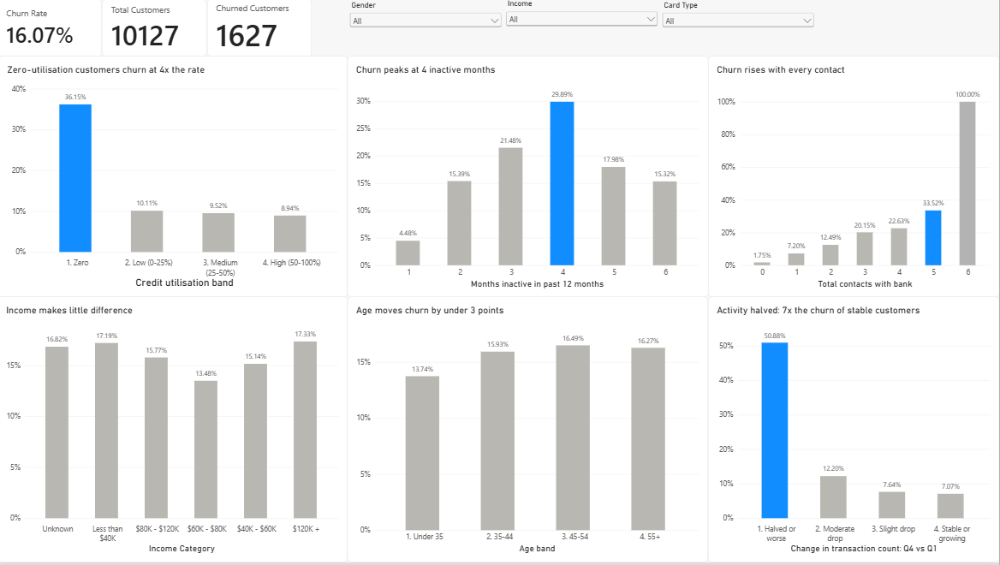
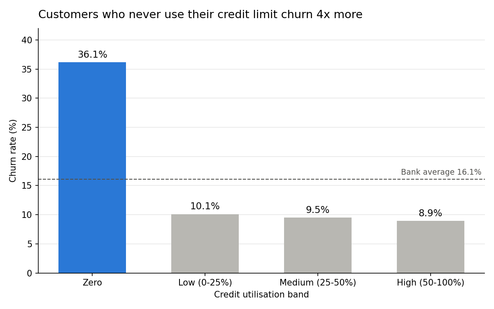
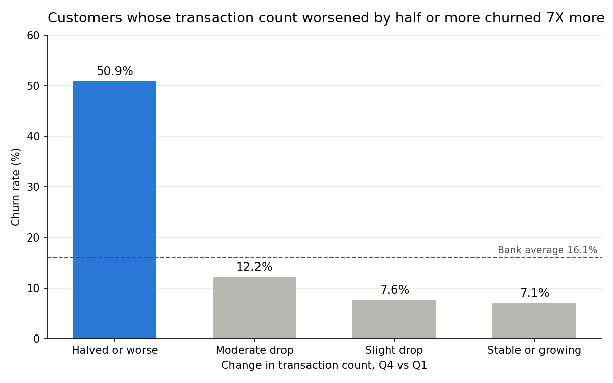
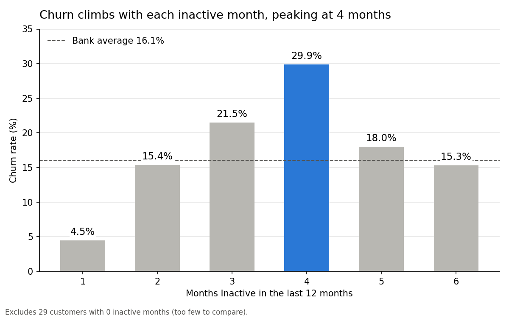
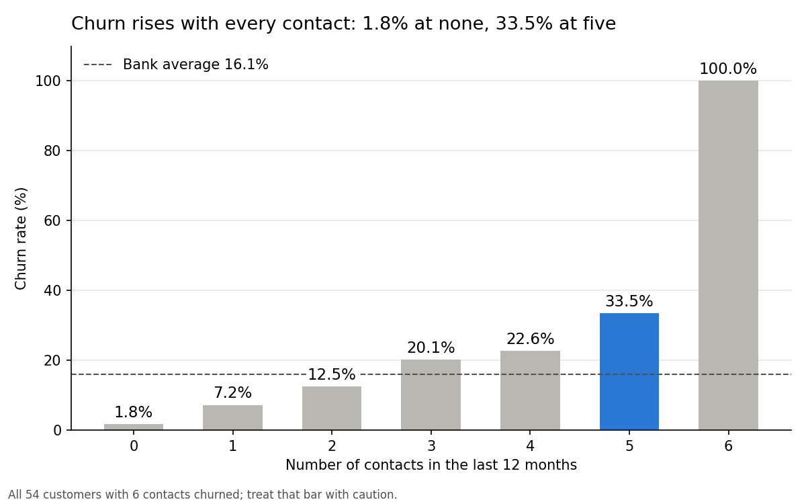
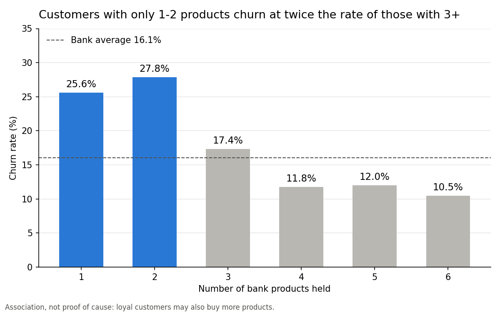
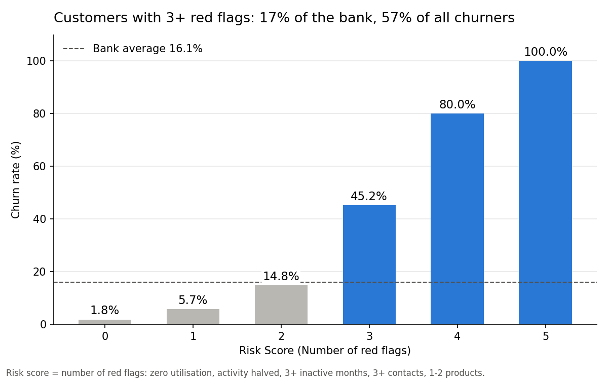
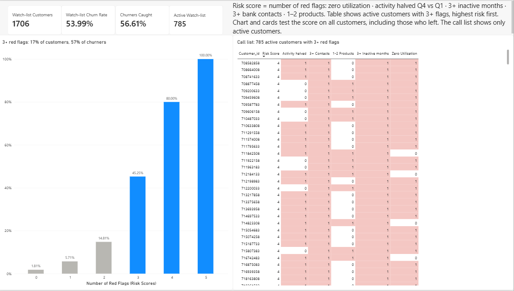

# Credit Card Customer Churn Analysis

**SQL · Python · Power BI**

A bank is losing credit card customers. This project finds out **who is leaving, why, and what the bank can do about it**, and ends with a risk score that flags **57% of churners from just 17% of customers**.



---

## Business problem

Keeping an existing customer costs far less than winning a new one. When a cardholder leaves, the bank loses the interest and fee income from that customer and has to spend money replacing them.

This analysis answers three questions:

1. **Who churns?** Do demographics or card type explain it?
2. **Why do they churn?** What behaviour comes before a customer leaves?
3. **What should the bank do?** Can at-risk customers be found early enough to act?

## Data

- **Source:** [Credit Card Customers (BankChurners)](https://www.kaggle.com/datasets/sakshigoyal7/credit-card-customers) on Kaggle
- **Size:** 10,127 customers, 21 columns (after dropping two leftover model-output columns)
- **Target:** `Attrition_Flag`, where 1,627 customers have churned (**16.07%**)
- **Key columns:** demographics (age, gender, income, education, marital status), card category, credit utilisation, transaction count and amount, months inactive, contacts with the bank, and number of bank products held
- **Data quality:** no missing values; unknowns are stored as the text `Unknown` (Education 1,519, Income 1,112, Marital Status 749) and kept as their own group

## Approach

| Step | Tool | What I did |
|---|---|---|
| 1. Data checks | MySQL | Row counts, missing values, baseline churn rate |
| 2. Who churns | MySQL | Churn rate by card type, income, gender, education, marital status, age band (conditional aggregation, `CASE WHEN` banding, CTE + `RANK`/`DENSE_RANK`/`ROW_NUMBER`) |
| 3. Why they churn | MySQL | Churn rate by transaction activity, inactivity, bank contacts, products held, credit utilisation and quarter-on-quarter activity change |
| 4. Deeper checks | Python (pandas, matplotlib) | Means vs medians, finding charts, and a rule-based **risk score** combining the five strongest signals |
| 5. Dashboard | Power BI | Two-page report: churn drivers, plus a retention watch-list with a call list of at-risk active customers |

---

## Key findings

### 1. Demographics barely matter

Most segments sit within a few points of the 16.07% average:

| Segment | Lowest churn | Highest churn |
|---|---|---|
| Gender | Male 14.62% | Female 17.36% |
| Age | Under 35: 13.74% | 45–54: 16.49% |
| Income | $60–80K: 13.48% | $120K+: 17.33% |
| Marital status | Married 15.13% | Single 16.94% |

Platinum cards (25%) and Doctorate holders (21%) look high, but they are small groups (20 and 451 customers), so I did not base recommendations on them. **The real drivers are behavioural.**

### 2. Churners stop using the card before they leave

| | Churned | Active | Difference |
|---|---|---|---|
| Avg. transactions per year | 44.9 | 68.7 | −35% |
| Avg. amount spent | $3,095 | $4,655 | −34% |
| Median amount spent | $2,329 | $4,100 | **−43%** |

The median gap is wider than the average gap: a few high spenders pull the churners' average up, so the typical churner spends even less than the average suggests.

### 3. Zero credit utilisation is the biggest single warning sign



Customers who use **none** of their credit limit churn at **36.15%**, about 4× the 9–10% of every other band. These 2,470 customers account for **55% of all churners**.

### 4. A sharp drop in activity signals a customer on the way out



Customers whose transaction count **halved** between Q1 and Q4 churn at **50.88%**, 7× the rate of customers whose activity held steady or grew (7.07%). This group is 14% of customers but **43% of churners**.

### 5. Inactivity and complaints build up before churn



- Churn rises from **4.48%** at 1 inactive month to **29.89%** at 4 months.
- Churn rises with every contact with the bank, from **1.75%** at zero contacts to **33.52%** at five. All 54 customers with six contacts churned.



### 6. Customers with more products stay



Customers holding only **1–2 products churn at 26.89%**, about double the 13.14% for customers with 3 or more. They make up 21% of the customer base.

---

## Risk score: turning findings into a watch-list

I combined the five strongest signals into a simple score of 0–5 red flags per customer:

| Red flag | Rule |
|---|---|
| Zero utilisation | `Avg_Utilization_Ratio = 0` |
| Activity halved | `Total_Ct_Chng_Q4_Q1 < 0.5` |
| Inactive 3+ months | `Months_Inactive_12_mon >= 3` |
| 3+ bank contacts | `Contacts_Count_12_mon >= 3` |
| Few products | `Total_Relationship_Count <= 2` |



| Red flags | Customers | Churn rate | Share of all churners |
|---|---|---|---|
| 0 | 1,543 | 1.81% | 1.7% |
| 1 | 3,746 | 5.71% | 13.2% |
| 2 | 3,132 | 14.81% | 28.5% |
| 3 | 1,306 | 45.25% | 36.3% |
| 4 | 350 | 80.00% | 17.2% |
| 5 | 50 | 100.00% | 3.1% |

Churn triples between 2 and 3 flags, so **3+ flags** is the natural cut-off for the watch-list:

- **1,706 customers (17% of the bank)**, churning at **53.99%**
- They account for **56.6% of all churners**
- **785 of them are still active.** This is the call list on page 2 of the dashboard.



---

## Recommendations

1. **Run the watch-list monthly.** Score every active customer and pass those with 3+ red flags to the retention team. Today that is 785 customers, a focused list rather than a bank-wide campaign.
2. **Set an early-warning trigger on falling activity.** Flag any customer whose transaction count drops by half quarter-on-quarter, or who reaches 2–3 inactive months, before they hit the 4-month peak.
3. **Activate zero-utilisation cardholders.** This group drives 55% of churn. Offers such as first-purchase cashback, EMI conversion or bill-payment set-up give them a reason to use the card.
4. **Cross-sell a third product** to customers holding only 1–2. Churn halves once customers hold 3 or more.
5. **Treat repeated contact as a service-recovery signal.** From the third contact in a year, route the customer to a senior team rather than standard support.

## Limitations

- **Thresholds were chosen on this same data.** The risk score should be tested on a later period (for example, the next quarter's customers) before the bank relies on it.
- **Some signals may arrive late.** Bank contacts could include the call to close the account. Zero utilisation and falling activity are the more useful *early* warnings.
- **Association, not cause.** Loyal customers may buy more products because they are loyal, not the other way round.
- **Small groups** (6 contacts, 0 inactive months, Platinum cards) show extreme rates from few customers and are noted rather than acted on.
- **One snapshot.** The data has no dates, so trends over time cannot be checked.

---

## Repository contents

```
├── README.md
├── sql/
│   └── churn_analysis.sql        # All MySQL queries, with comments
├── notebooks/
│   └── churn_analysis.ipynb      # Python checks, charts and risk score
├── dashboard/
│   └── churn_dashboard.pbix      # Power BI report (2 pages)
└── images/                       # Charts and dashboard screenshots
```

## How to reproduce

1. Download `BankChurners.csv` from the Kaggle link above and drop the two `Naive_Bayes` columns.
2. Load it into MySQL as `customer_churn_bank.bankchurners` and run `sql/churn_analysis.sql`.
3. Open `notebooks/churn_analysis.ipynb` in Google Colab, upload the CSV and run all cells. The last cell exports `bankchurners_powerbi.csv`.
4. Open `dashboard/churn_dashboard.pbix` in Power BI Desktop and point it to the exported CSV if prompted.

---

**Author:** Satyadeep · [LinkedIn](https://www.linkedin.com/in/your-profile) · [Email](mailto:your-email)
